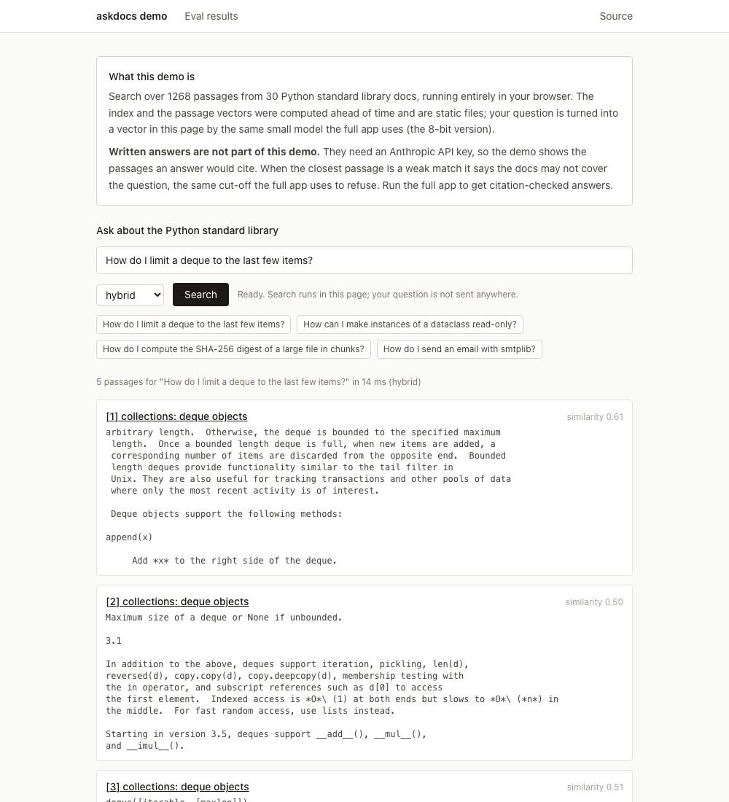

# The browser demo

A version of askdocs that runs as a static website: https://andyhetianjun.github.io/askdocs/

You type a question, and it shows the five passages from the Python docs that match best, with a link to each doc. There is no server. Your question never leaves the page.

**What it does not do:** write answers live. A written answer needs a model, and a model needs an API key, so this demo shows the passages an answer would cite. The full app (see the README) writes answers and checks each sentence against its citation when you give it a key. If answers have been recorded with the harness in [RECORDING.md](../RECORDING.md), the page also has a "Recorded answers" section where you pick a question and see the recorded answer, the passages the model was given and the checker's verdict on each sentence. They are recorded once, not live calls. Without recordings that section is hidden.



## Why it is built this way

I wanted a version anyone can open without installing anything, so the only honest option was to make the search work with no backend. That needs two things in the browser:

1. **The index.** The 1268 passages and their vectors were computed ahead of time by `npm run ingest` and are shipped as one static file (`data/index.json`, about 4 MB). Keyword search (BM25) and rank fusion are the same TypeScript files the full app uses.
2. **The question vector.** The question is embedded in the page by the same small model as the full app (all-MiniLM-L6-v2), run with transformers.js. The page loads the library from a CDN and the 8-bit version of the model (about 23 MB) from Hugging Face on first use; the browser caches it after that. I checked that the 8-bit vectors are close to the full ones the index was built with (mean cosine similarity 0.997 on the 30 eval questions).

If the model cannot be loaded (blocked CDN, offline), the page says so and falls back to keyword search only.

It also applies the "I couldn't find this in the docs" cut-off (0.45 similarity) from [trustworthy-answers.md](trustworthy-answers.md) to the closest passage, and shows the nearest passages anyway.

The `/eval/` page shows the measured results from the other docs as static tables. They were run on a laptop with the Node version of the project and copied from `data/results/*.json` at build time; they are not measured in your browser.

## Build and deploy

```bash
npm run build:demo       # copies data/index.json next to the pages, then a static Next.js export into demo/out
```

The site is served under `/askdocs/`, so `demo/next.config.mjs` sets `basePath` to that. `.github/workflows/pages.yml` builds it on every push to main and deploys it with GitHub Pages.

To look at it locally, serve the folder above `demo/out` under the name `askdocs`, for example by linking `demo/out` to `askdocs` in a temp folder and running a static file server there.

## Checked

I built it and opened it in headless Chromium: the index loads, the model loads from the CDN and Hugging Face, "How do I limit a deque to the last few items?" returns the deque section first (similarity 0.61), and "How do I send an email with smtplib?" shows the "couldn't find this" notice. No console errors. I have not tested it on a phone or in Safari.
