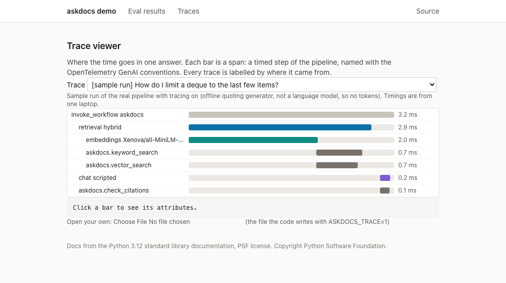

# Tracing: where the time goes in each answer

## Why I added this

I wanted to see where time and tokens go in each answer. The app already keeps a simple request log (the `/traces` page: total time, retrieval time, chunks, tokens), but that is one number per request. It does not say whether the time went into embedding the question, searching, the model, or the citation check.

Tracing records each step of one answer as a small timed record called a span, and nests them so you can read one answer as a waterfall. I used OpenTelemetry, the standard way to record traces, so the output works with tools I did not write. Its GenAI conventions fix the names of the attributes for model calls, retrieval and embeddings (`gen_ai.operation.name`, `gen_ai.usage.input_tokens` and so on).



You can look at real ones now on the demo's [Traces page](https://andyhetianjun.github.io/askdocs/traces/). Traces labelled "recorded" are built from the saved Claude Sonnet 5.5 recordings; "sample run" ones come from the real pipeline run with tracing on.

## Try it

Nothing external is needed. Tracing is off unless you ask:

```bash
npx askdocs ask "how do I limit a deque to the last few items?" --trace
```

(From a clone, `npx tsx scripts/cli.ts ask "..." --trace` is the same.) That writes `traces/askdocs.otlp.jsonl`: one OTLP JSON document per line, the format the OpenTelemetry collector's file exporter uses. Open it with "Open your own" on the Traces page. `ASKDOCS_TRACE=1` does the same as `--trace` and also turns tracing on for the web app (`npm run dev`); `ASKDOCS_TRACE_FILE=somewhere.jsonl` changes the path.

To send traces to Jaeger (or any OTLP endpoint) set the standard variable:

```bash
docker compose -f docker-compose.tracing.yml up -d
ASKDOCS_TRACE=1 OTEL_EXPORTER_OTLP_ENDPOINT=http://localhost:4318 npx askdocs ask "how do I use a deque?"
# then open http://localhost:16686 and pick the service "askdocs"
```

I could not run Docker on my Mac, so the compose file is untested against a real Jaeger. CI checks that the file parses (`docker compose config`), and a unit test checks that the endpoint variable selects the OTLP HTTP exporter, but nobody has seen a trace arrive in Jaeger yet. The other `OTEL_EXPORTER_OTLP_*` variables (headers, timeout) are read by the OpenTelemetry exporter itself. When an endpoint is set the file is not written, unless you also set `ASKDOCS_TRACE_FILE`.

## What gets recorded

One question is one trace:

```
invoke_workflow askdocs
  retrieval hybrid
    embeddings Xenova/all-MiniLM-L6-v2     the question becomes a vector
    askdocs.keyword_search                 these two run at the same time
    askdocs.vector_search
  chat claude-sonnet-5-5                   the answer (only when a model is set)
  askdocs.check_citations                  the sentence-by-sentence check
```

| Span | Main attributes |
| --- | --- |
| `invoke_workflow askdocs` | `gen_ai.operation.name`, `gen_ai.workflow.name`, `askdocs.abstained`, `askdocs.abstain_reason`, `askdocs.chunks_returned` |
| `retrieval <mode>` | `gen_ai.operation.name = retrieval`, `gen_ai.data_source.id`, `askdocs.retrieval.k`, `.results`, `.top_similarity` |
| `embeddings <model>` | `gen_ai.operation.name = embeddings`, `gen_ai.provider.name`, `gen_ai.request.model`, `gen_ai.embeddings.dimension.count` |
| `chat <model>` (client span) | `gen_ai.provider.name`, `gen_ai.request.model`, `gen_ai.response.model`, `gen_ai.usage.input_tokens`, `gen_ai.usage.output_tokens` |
| `askdocs.check_citations` | `askdocs.sentences`, `askdocs.sentences_dropped` |

With an API key the citation check is also made by the model, one short call per sentence; each of those is its own `chat` span (`askdocs.purpose = citation_check`) with its tokens.

Errors: an exception inside any step is recorded on that span (status ERROR, `error.type`, an `exception` event) and on its parents, then thrown again as before. If the model call fails the answer falls back to the passages, as it did before, and the `chat` span shows the error. Each request in the old `/traces` log also gets an `otelTraceId`, so you can find it in a viewer.

Things worth knowing:

- Token counts are only there when the model reports them. The offline quoting generator is not a model, so its `chat` span has no token attributes. I do not make numbers up.
- `invoke_workflow` and the `gen_ai.data_source.id` / `gen_ai.embeddings.*` names are from the GenAI conventions as I read them when I wrote this. They are still changing, so a newer OpenTelemetry version may rename some. Names starting with `askdocs.` are mine.
- The question and the answer are not recorded unless `ASKDOCS_TRACE_CONTENT=1`, since they can hold anything someone typed.

## What the recorded traces can and cannot show

The saved recordings come from a harness where a Claude session was shown each question with its retrieved passages and typed back an answer ([RECORDING.md](../RECORDING.md)). A recording keeps when the session was shown the prompt and when the answer was saved, and nothing in between. Retrieval had already happened before that, and was not timed. So a recorded trace in the viewer is just two spans of the same length: the workflow and one model call. It shows how long the answer took (about 2 seconds each), and not what was inside that time or any token counts. The "sample run" traces are the ones with the inside of the pipeline, but they use the offline quoting generator, so they say how long retrieval and checking take and nothing about how long a model takes.

## Overhead

Measured with `npm run bench:tracing -- 30` on my laptop: the 42 eval questions (30 answerable, 12 not) through the full pipeline with the real index and the real local embedding model, the offline quoting generator, tracing off and then on (file exporter, flushed at the end), 30 rounds alternating, median of each. I ran it three times because the numbers moved a little:

| | per run of 42 questions | per question |
| --- | --- | --- |
| tracing off | 94 to 95 ms | 2.2 to 2.3 ms |
| tracing on | 97 to 98 ms | 2.3 ms |
| difference | 2 to 4 ms (2.3% to 4.3%) | 0.05 to 0.10 ms |

With the fast hash embedder (`--hash`), where a question takes under a millisecond, one run gave 30 ms off and 32 ms on (5.8%). A run is about 270 to 290 spans and about 160 to 175 KB of file. So a question costs roughly 0.05 to 0.1 ms to trace, and the percentage mostly depends on how fast the rest is. A model call takes about 2 seconds in the recordings, so against a real model this is a tiny share, but I have not measured it against a live model. When tracing is off the code uses OpenTelemetry's no-op tracer; I did not measure that separately and the "off" column includes it.

## Tests

`tests/tracing.test.ts` checks the span tree (parents, one trace id, seven spans for a normal question), the `gen_ai.*` attributes, token counts for a model that reports them and none for the offline one, abstaining, a failing embedder, a failing model, that content is off by default, that nothing happens when tracing is off, that the file is valid OTLP JSON with hex ids, which exporter each environment picks, and that the compose file parses. `tests/trace-view.test.ts` checks how a recording becomes spans.

```bash
npx vitest run tests/tracing.test.ts tests/trace-view.test.ts
```

To rebuild the sample traces the demo shows: `npm run traces:sample` (writes `data/results/sample-traces.json`; timings are from whichever machine ran it), then `npm run build:demo`.
